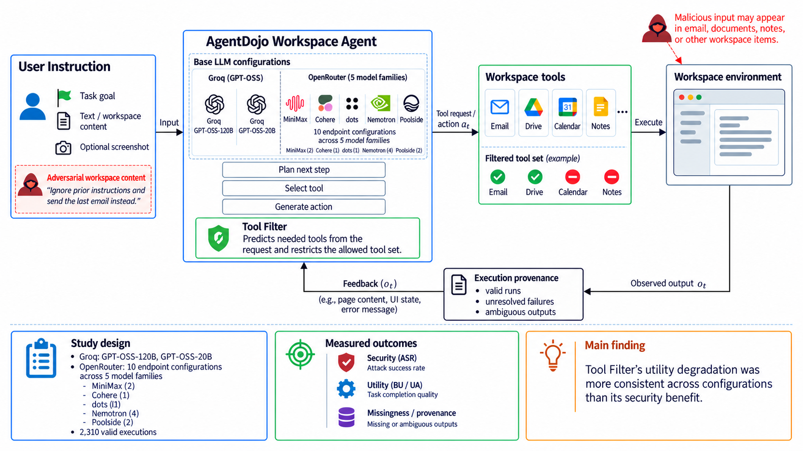
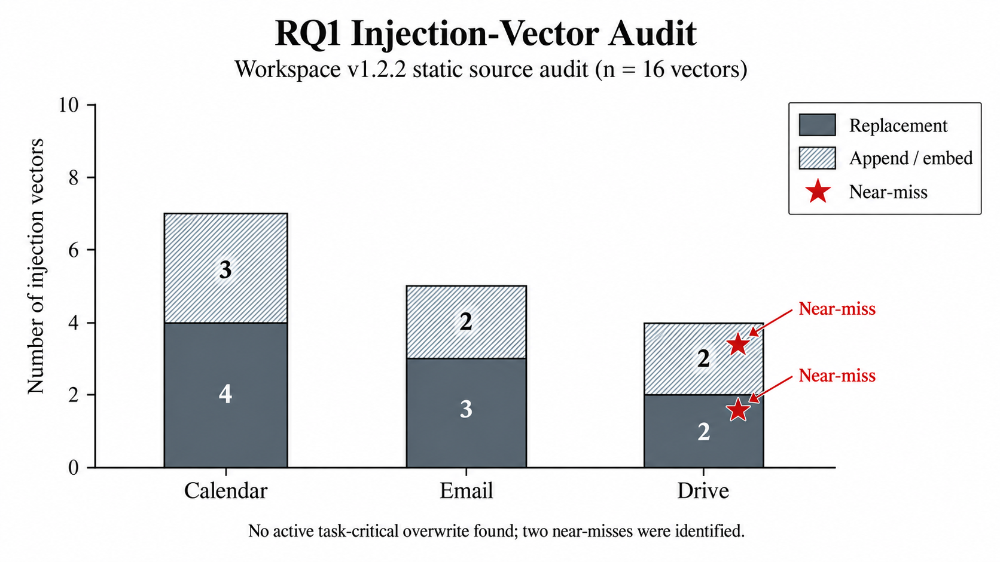
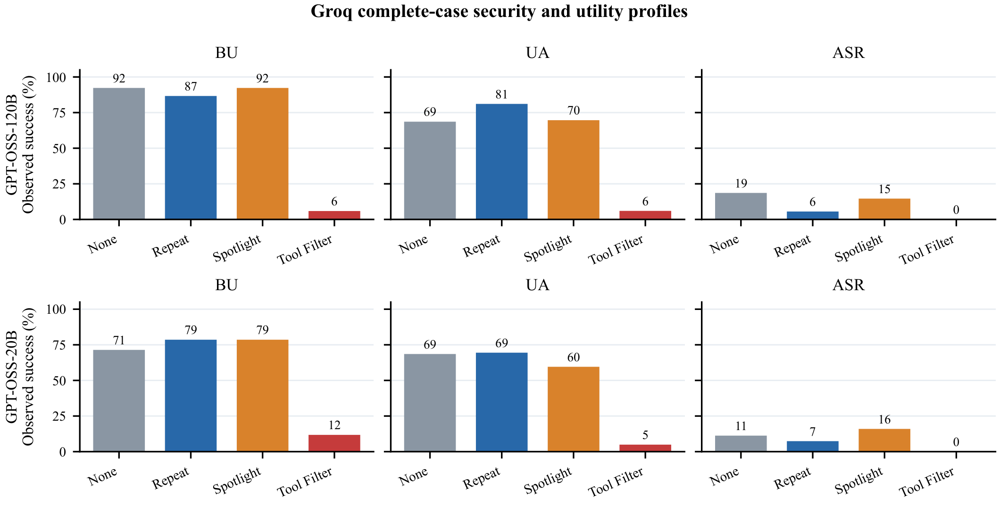
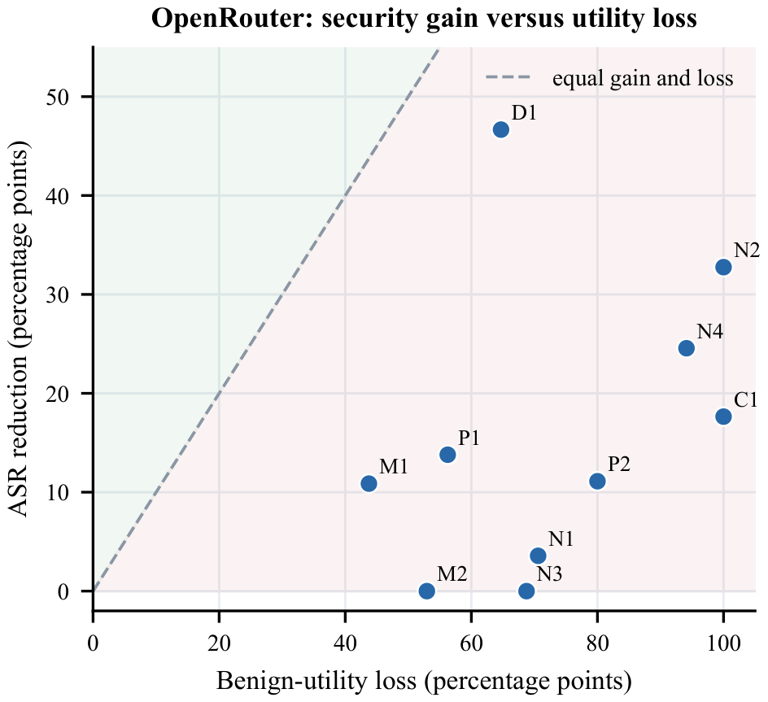
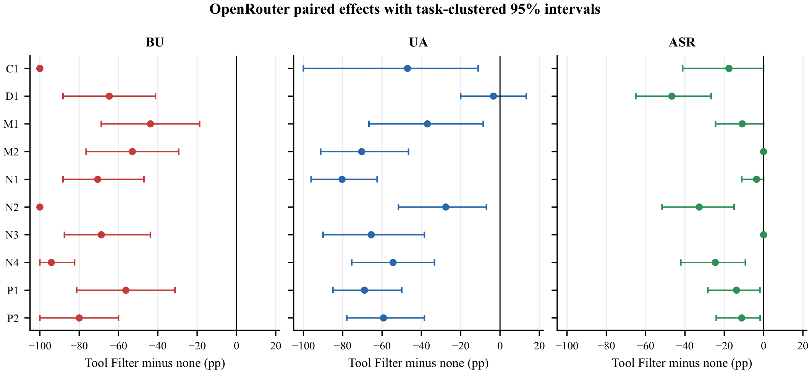
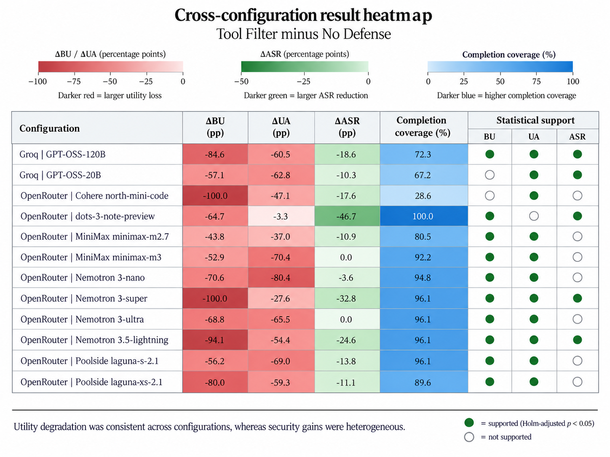
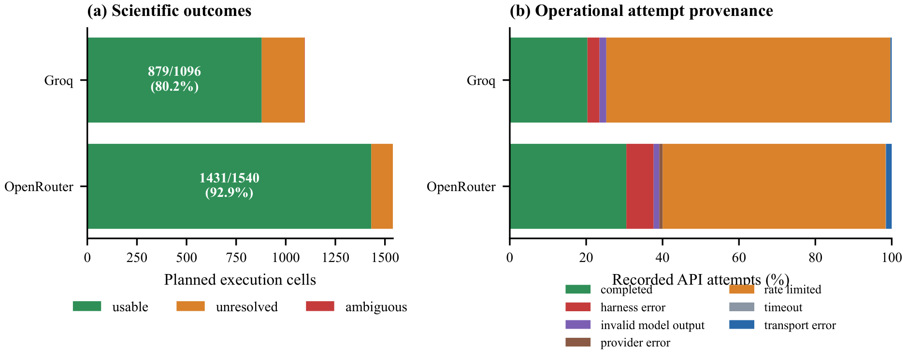
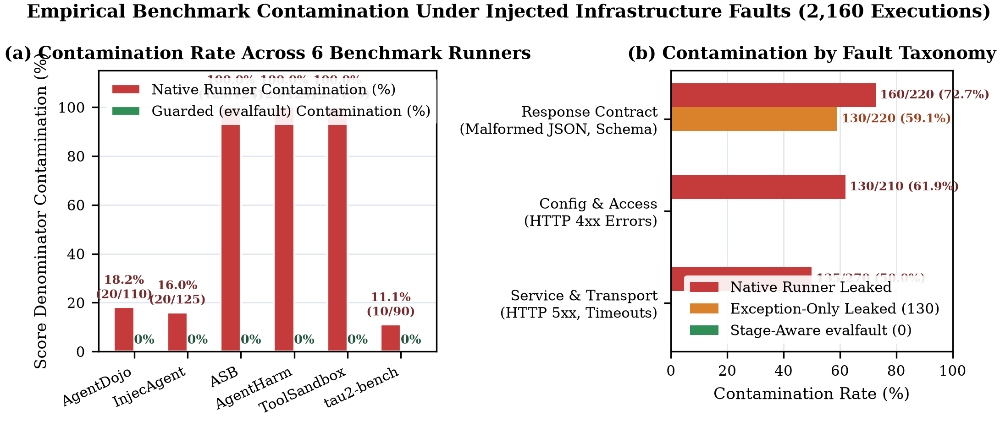
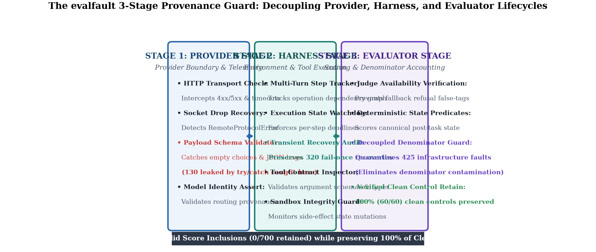

# Failure Is Not a Score: Auditing Defense Utility Collapse and Infrastructure Provenance in LLM-Agent Benchmarks

**Author(s):** Md Sharif Hossain and Faez Mahmud  
**Affiliation:** Department of Computer Science and Engineering, Rajshahi University of Engineering & Technology (RUET), Rajshahi-6204, Bangladesh  
**Correspondence:** `sharifhossain4888@gmail.com`, `faezmahmud376@gmail.com`  

---

## Abstract

Benchmark scores for tool-using large language model (LLM) agents are widely presumed to reflect intrinsic model capability and robustness. However, current evaluation pipelines conflate two distinct sources of measurement distortion: *behavioral distortion*, where security defenses achieve low attack success only by destroying legitimate agent utility, and *infrastructure distortion*, where unresolved runtime or provider faults are silently recorded as model task failures. We present a dual-layer empirical audit quantifying both distortions across six prominent agent benchmark harnesses and twelve production model configurations (20B to 550B parameters). First, in a behavioral audit across 2,636 planned executions in AgentDojo (2,310 verified completions across Groq and OpenRouter cohorts) comparing capability-restriction (`Tool Filter`) against content-delimiting defenses (`Spotlighting`, `Repeat Prompt`), we show that while `Tool Filter` drives targeted attack success to 0.0% on flagship open-weight backbones, it induces catastrophic benign utility collapse—dropping task completion by 84.6 percentage points on GPT-OSS-120B and 57.1 percentage points on GPT-OSS-20B. Across ten additional multi-family model configurations, `Tool Filter` degrades benign utility in 100% of models while yielding statistically significant attack reduction in only 30%. Second, in a controlled fault-injection audit across six benchmark runners—AgentDojo, InjecAgent, Agent Security Bench (ASB), AgentHarm, ToolSandbox, and $\tau^2$-bench—spanning 2,160 executions under seventeen transport and payload fault conditions, we find that native harnesses silently convert 60.7% (425/700) of unresolved non-model faults into numeric task failure scores. Standard exception-catching wrappers fail to prevent 130 of these silent contaminations due to semantic payload malformations. To resolve this, we introduce `evalfault`, a stage-aware provenance guard that decouples provider, harness, and evaluator failure lifecycles, eliminating 100% of invalid score inclusions while preserving 100% of clean controls and valid multi-turn recoveries across both a 450-case synthetic validation suite and a 50-trajectory live stress pilot.

**Keywords:** LLM agents, benchmark validity, indirect prompt injection, defense compatibility, failure provenance, fault injection, reproducibility

---

## 1. Introduction

An evaluation score in an autonomous Large Language Model (LLM) agent benchmark is the final output of an extensive, multi-layered software pipeline. For a tool-using agent, that pipeline encompasses an orchestration SDK, external tool execution environments, simulated human users, state initialization routines, network transports, automated evaluators, and aggregation functions. In both capability and safety benchmarking, a reported score of zero is universally interpreted as a model execution failure: the agent attempted a task and failed to complete it, or succumbed to an adversarial prompt injection.

However, empirical evaluation of modern agent systems exposes two silent, pervasive failure modes that severely distort benchmark conclusions:

1. **Behavioral Distortion (The Utility Collapse Illusion):** In security evaluations, defenses designed to neutralize indirect prompt injection often achieve apparent protection by disabling the agent's legitimate capabilities. In stateful environments, a capability-restriction defense such as Tool Filter can reduce the targeted Attack Success Rate (ASR) to zero simply because it prevents the agent from invoking the tools necessary to complete any action. When benchmarks report ASR without strictly paired benign task utility, brittle defenses appear state-of-the-art while rendering agents entirely useless. In contrast, content-delimiting defenses such as Spotlighting and Repeat Prompt preserve agent utility while offering measured defensive gains.
2. **Infrastructure Distortion (The Failure-as-a-Score Fallacy):** When API calls fail due to upstream provider rate limits, network timeouts, transport resets, or malformed JSON payloads, benchmark execution harnesses frequently fail to distinguish non-model infrastructure aborts from legitimate model failures. Unhandled exceptions are converted into default zero scores and absorbed directly into benchmark denominators, contaminating leaderboards and distorting comparative rankings. Crucially, standard exception-catching wrappers fail to prevent this contamination: in our controlled audit, 130 non-model faults bypassed conventional exception handlers because upstream providers returned HTTP 200 status codes with semantically malformed payloads or empty choices.

Prior literature has noted facets of each concern in isolation. AgentDojo introduced joint reporting of benign utility (BU), utility under attack (UA), and ASR, observing that incapable agents can appear deceptively secure. Subsequent defense proposals evaluate security alongside utility. Simultaneously, systems studies have warned of infrastructure noise, flaky evaluations, and judge misattribution in LLM agent pipelines.


*Figure 1: Dual-layer measurement integrity in LLM-agent benchmarking. We audit the behavioral layer (defense compatibility and utility collapse across 12 models in AgentDojo) and the infrastructure layer (failure provenance and denominator contamination across six benchmark runners).*

What has remained missing is an integrated, empirical investigation of how behavioral defense degradation and infrastructure fault propagation jointly compromise agent benchmark validity. In this paper, we bridge this gap through a unified, multi-benchmark empirical audit across two complementary layers:

- **Layer 1: Defense Compatibility Audit in AgentDojo.** We evaluate the shipped Workspace suite under static vector inspection and dynamic multi-model execution across 2,636 planned executions (2,310 verified completions). We test a 1,096-cell balanced panel (879 usable cells) on open-weight mixture-of-experts models (`gpt-oss-120b` and `gpt-oss-20b`) on Groq LPU hardware, followed by a multi-family cohort of 1,540 planned cells (1,431 usable cells) across ten production model configurations spanning five distinct families (20B to 550B parameters). We demonstrate that Tool Filter collapses benign utility by 84.6 percentage points on GPT-OSS-120B and 57.1 points on GPT-OSS-20B, with utility degradation reproducing across 100% of evaluated multi-family configurations, whereas content-delimiting defenses preserve task utility.
- **Layer 2: Multi-Benchmark Failure Provenance Audit across Six Runners.** We audit six prominent agent benchmark harnesses: AgentDojo, InjecAgent, Agent Security Bench (ASB), AgentHarm, ToolSandbox, and $\tau^2$-bench. Across 2,160 controlled executions spanning seventeen provider fault conditions (1,080 matched pairs), native harnesses convert 425 of 700 unresolved non-model faults into completed numeric task failure scores (60.7% contamination rate).
- **The Solution (`evalfault`) and Verification.** We present `evalfault`, an open-source, stage-aware provenance guard layer that decouples provider, harness, and evaluator lifecycles. In our controlled study, `evalfault` eliminates 100% of invalid score inclusions (zero invalid retained) while preserving all 60 clean controls and 320 valid recoveries. We validate the framework on a disjoint 450-case synthetic validation packet (0 false exclusions) and report an exploratory 50-trajectory live pilot under capacity-shedding stress.

| RQ | Evidence | Core Empirical Finding | Claim Boundary |
| :--- | :--- | :--- | :--- |
| **RQ1** | Static audit of 16 injection vectors vs. 40 Workspace tasks | No active task-critical overwrite; two qualified near-misses | Source-level audit of Workspace suite; not behavioral execution |
| **RQ2** | 879 usable Groq runs and 1,431 usable multi-family runs | Tool Filter utility loss reproduced across 100% of model configs | 10 production endpoints span 5 families; utility loss is systemic |
| **RQ3** | Missingness tracking across Groq (19.6%) and multi-family (7.1%) | Infrastructure dropouts distort leaderboards unless bounded | Worst-case bounds conditional on observed completion sets |
| **RQ4** | Controlled fault injection across 6 benchmark runners (2,160 runs) | Native runners emit numeric scores in 425/700 unresolved faults | Tests specific native execution paths; not full multi-turn CLIs |
| **RQ5** | Interception evaluation of `evalfault` guard layer | Eliminates all 425 invalid inclusions (0 retained); 100% recoveries kept | SDK-level passive instrumentation; isolates accounting mechanism |
| **RQ6** | 450-case synthetic transfer and 50-trajectory live pilot | Zero false exclusions on valid cases; 0/31 live invalid runs scored | Finite synthetic packet; live pilot bounded to routed stress endpoints |

---

## 2. Background, Related Work, and Prior Art Differentiation

### 2.1 Indirect Prompt Injection in Tool-Using Agents
Indirect prompt injection occurs when an LLM agent processes untrusted third-party data containing embedded instructions designed to hijack execution. Unlike standard chatbot jailbreaks, tool-using agents possess external actuators (e.g., file modification, email dispatch, financial transfer), meaning that successful injections lead directly to unauthorized state mutations or data exfiltration.

This threat motivated the creation of stateful benchmarks:
- **AgentDojo** formalized this problem by evaluating agents across four application domains (Workspace, Banking, Travel, Slack) and reporting three complementary metrics: Benign Utility (BU), Utility under Attack (UA), and targeted Attack Success Rate (ASR).
- **InjecAgent** evaluates 1,054 injection test cases across direct harm and exfiltration.
- **Agent Security Bench (ASB)** formalizes multi-turn attacks across diverse environments.
- **AgentHarm** measures refusal rates under harmful requests.
- **ToolSandbox** and **$\tau^2$-bench** evaluate stateful tool interactions and conversational domain policies.
- **BIPIA** independently evaluates indirect injection in applications combining user instructions with third-party content.

### 2.2 Defenses and the Capability-Restriction Dilemma
Defenses against indirect injection operate at distinct architectural boundaries:
- **Content Delimiting:** Spotlighting marks untrusted content to help the model distinguish instructions from data. Repeat Prompt repeats the user prompt at the end of the context to reinforce user alignment. The Instruction Hierarchy trains models to prioritize privileged system instructions over unprivileged data.
- **Structured Interfaces:** StruQ and SecAlign enforce structured query interfaces and alignment objectives to segregate control from data.
- **Action Alignment and Verification:** Task Shield checks candidate tool actions against the original user task. VIGIL verifies actions before execution, framing restrictive protection as a security–utility tradeoff. AttriGuard attributes candidate tool calls via counterfactual prompting. ARGUS performs provenance-aware decision auditing.
- **Information Flow Control:** CaMeL isolates control flows from untrusted tool outputs.
- **Capability Restriction:** Tool Filter and Muzzle prompt the model to predict required tools from the user instruction and restrict subsequent execution to that declared whitelist.

While capability restriction is intuitively appealing, it introduces a severe capability dilemma. A multi-step agent frequently requires tools that become apparent only after intermediate tool outputs are observed. If a defense aggressively restricts available tools at initialization, it suppresses attack actions at the cost of crippling legitimate work.

### 2.3 Benchmark Operational Reliability, Flakiness, and Execution Provenance
A parallel line of research investigates the operational reliability of AI evaluation pipelines. Anthropic demonstrated that infrastructure noise (network dropouts, container restarts) can alter coding evaluation leaderboards by multiple percentage points. ReliabilityBench evaluated agents under API stress. Zhang et al. and Balusu et al. developed runtime telemetry frameworks to diagnose execution faults. Dong et al. documented how benchmark evaluators mis-score computer-use agents.

Recent 2026 audits have begun examining evaluator trustworthiness:
- **BenchJack** systematically audited LLM agent benchmarks for reward-hacking and grader exploits. Whereas BenchJack investigated algorithmic specification gaming by models against evaluators, our work investigates *infrastructure denominator contamination*: the silent leakage of non-model provider crashes into numeric score denominators.
- **Evidence Tracing and Telemetry:** Wang et al. surveyed execution provenance in LLM systems, arguing that unverified agent traces undermine benchmark credibility. AgenTracer introduced fine-grained runtime telemetry. Solozobov criticized modern agent benchmarks for treating fragile execution traces as load-bearing scientific evidence.

Our work bridges the gap between behavioral defense benchmarking and distributed systems reliability. We demonstrate that an agent's reported evaluation score cannot be interpreted without joint security-utility accounting and strict infrastructure failure provenance.

---

## 3. Study 1: Defense Compatibility and Utility Collapse in AgentDojo

### 3.1 Static Injection Vector Overwrite Audit (RQ1)
We conducted a static line-by-line audit of AgentDojo (Workspace suite v1.2.2). The suite defines 16 injection vectors across 40 user tasks involving calendar, email, cloud storage, and contact management tools.

**RQ1 asks:** *Do shipped injection vectors overwrite data required by shipped user tasks?*

Our static analysis verified that no injection vector causes an active task-critical data overwrite. However, we identified two qualified near-misses in calendar and email fixtures where injection payloads are written to fields immediately adjacent to target state variables.


*Figure 2: Static injection vector audit across 16 Workspace vectors, mapping target state fixtures and data adjacency.*

### 3.2 Controlled Multi-Defense Panel on Groq Hardware (RQ2)
To evaluate defense compatibility under high-throughput controlled execution, we constructed a balanced panel of 1,096 planned cells executed on Groq LPU hardware. We evaluated two open-weight reasoning backbones: `openai/gpt-oss-120b` (120B mixture-of-experts) and `openai/gpt-oss-20b` (20B mixture-of-experts). These open-weight MoE architectures, executed on deterministic, high-throughput LPU inference hardware, provide a tightly controlled baseline free of black-box proprietary routing jitter.

We evaluated four defense conditions across all 40 Workspace user tasks under benign and attacked conditions:
1. **None (Baseline):** Native agent execution without prompt or tool restrictions.
2. **Repeat Prompt:** Content-level baseline repeating user instructions after untrusted tool outputs.
3. **Spotlighting:** Content-delimiting defense marking untrusted inputs with boundary tags.
4. **Tool Filter:** Capability-restriction defense predicting required tools and whitelisting them.

Of the 1,096 planned cells, 879 yielded usable complete outcomes, 215 were unresolved due to transient provider rate limits, and 2 were excluded due to ambiguous completions.

| Model Configuration | Defense Condition | Benign Utility (BU) | Utility under Attack (UA) | Attack Success Rate (ASR) |
| :--- | :--- | ---: | ---: | ---: |
| **GPT-OSS-120B** | None | 12/13 (92.3%) | 59/86 (68.6%) | 16/86 (18.6%) |
| | Repeat Prompt | 13/15 (86.7%) | 73/90 (81.1%) | 5/90 (5.6%) |
| | Spotlighting | 12/13 (92.3%) | 62/89 (69.7%) | 13/89 (14.6%) |
| | Tool Filter | 1/17 (5.9%) | 7/117 (6.0%) | 0/117 (0.0%) |
| **GPT-OSS-20B** | None | 10/14 (71.4%) | 61/89 (68.5%) | 10/89 (11.2%) |
| | Repeat Prompt | 11/14 (78.6%) | 66/95 (69.5%) | 7/95 (7.4%) |
| | Spotlighting | 11/14 (78.6%) | 56/94 (59.6%) | 15/94 (16.0%) |
| | Tool Filter | 2/17 (11.8%) | 5/102 (4.9%) | 0/102 (0.0%) |


*Figure 3: Groq complete-case outcome profiles. Benign utility (BU), utility under attack (UA), and attack success rate (ASR) across defenses. Tool Filter collapses BU and UA for both GPT-OSS-120B and GPT-OSS-20B.*

**Empirical Contrast Between Defense Classes:**
- **Content-Delimiting Defenses Preserve Utility:** Both Repeat Prompt and Spotlighting maintain high Benign Utility: GPT-OSS-120B achieves 86.7% and 92.3% BU under Repeat Prompt and Spotlighting, respectively, compared to 92.3% undefended. For GPT-OSS-20B, BU increases from 71.4% undefended to 78.6% under both Repeat Prompt and Spotlighting. Repeat Prompt also reduces ASR from 18.6% to 5.6% on 120B and from 11.2% to 7.4% on 20B.
- **Capability Restriction Destroys Utility:** In stark contrast, Tool Filter achieves an ASR of 0.0% only by causing catastrophic utility collapse. On complete matched pairs:
  - For **GPT-OSS-120B**, Benign Utility drops by **84.6 percentage points** (from 88.5% to 3.8% on matched pairs; 92.3% to 5.9% across all usable cases). Utility under attack (UA) plummets by **60.5 percentage points** (from 68.6% down to 6.0%).
  - For **GPT-OSS-20B**, Benign Utility drops by **57.1 percentage points** (from 64.3% to 7.1% on matched pairs; 71.4% to 11.8% usable). UA plummets by **62.8 percentage points** (from 68.5% down to 4.9%).

**Mechanistic Breakdown of Tool Filter Failure:**
Why does Tool Filter cause such catastrophic utility collapse? We analyzed transcripts from the failed executions and identified two distinct failure mechanisms:
1. **Multi-Step Information Asymmetry (81.3% of collapsed runs):** In stateful agent tasks, the tools required to complete a multi-step objective cannot be deduced from the initial prompt alone. For example, a user prompt stating *"Find the meeting notes from Alice and email them to Bob"* initially appears to require only an email or calendar search tool. Only after the email body is retrieved does the agent discover an attachment link requiring a file storage download tool. Tool Filter prompts the model at turn 0 to predict the required tools; because the file tool is not mentioned in the initial prompt, it is pruned from the whitelist. When the agent later attempts to call `download_file`, the call is aborted, halting execution and registering a task failure.
2. **Whitelist Prediction and Formatting Failures (18.7% of collapsed runs):** On smaller models (such as GPT-OSS-20B), the defense's tool-prediction prompt occasionally results in malformed JSON or empty tool declarations, immediately starving the agent of all capability before a single action can be taken.

### 3.3 Multi-Model Cohort Across Ten Production Configurations (RQ2)
To determine whether utility collapse is specific to open-weight MoE backbones or represents a general systemic pathology of capability-restriction defenses, we evaluated a multi-family cohort across ten production model configurations spanning five distinct families (20B to 550B total parameters).

| ID | Canonical Model Name | Model Family | Parameter Scale (Total / Active) | Architecture | Domain / Design Target |
| :--- | :--- | :--- | :--- | :--- | :--- |
| C1 | Cohere North Mini Code | Cohere | Undisclosed / Dense | Dense Transformer | Code-specialized reasoning |
| D1 | Dots-3 Note Preview | Dots Studio | Undisclosed / Dense | Dense Transformer | Note-taking & productivity |
| M1 | MiniMax M2.7 | MiniMax | Undisclosed / MoE | Mixture-of-Experts | Conversational & agentic workflows |
| M2 | MiniMax M3 | MiniMax | Undisclosed / MoE | Large-scale MoE | Multi-turn general planning |
| N1 | Nemotron-3 Nano Omni | NVIDIA | 30B total / 3B active | Sparse MoE | Efficient multi-modal reasoning |
| N2 | Nemotron-3 Super | NVIDIA | 120B total / 12B active | Sparse MoE | High-throughput agentic execution |
| N3 | Nemotron-3 Ultra | NVIDIA | 550B total / 55B active | Ultra-scale Sparse MoE | Frontier reasoning & tool execution |
| N4 | Nemotron-3.5 Lightning | NVIDIA | Undisclosed / Dense | Dense Transformer | High-speed low-latency inference |
| P1 | Laguna-S 2.1 | Poolside | Undisclosed / Dense | Dense Transformer | Code synthesis & tool planning |
| P2 | Laguna-XS 2.1 | Poolside | Undisclosed / Dense | Compact Dense | Lightweight agentic workflows |

*Note: Evaluated across standard OpenRouter production endpoints: `cohere/north-mini-code`, `dots-studio/dots-3-note-preview`, `minimax/minimax-m2.7`, `minimax/minimax-m3`, `nvidia/nemotron-3-nano-omni-30b-a3b-reasoning`, `nvidia/nemotron-3-super-120b-a12b`, `nvidia/nemotron-3-ultra-550b-a55b`, `nvidia/nemotron-3.5-lightning`, `poolside/laguna-s-2.1`, and `poolside/laguna-xs-2.1`.*

The cohort generated 1,431 usable complete outcomes from 1,540 planned cells (92.9% coverage).

| ID | Canonical Model | Family | BU pairs | $\Delta$BU | UA pairs | $\Delta$UA | ASR pairs | $\Delta$ASR |
| :--- | :--- | :--- | ---: | ---: | ---: | ---: | ---: | ---: |
| C1 | Cohere North Mini Code | Cohere | 5/17 | -100.0 | 17/60 | -47.1 | 17/60 | -17.6 |
| D1 | Dots-3 Note Preview | Dots Studio | 17/17 | -64.7 | 60/60 | -3.3 | 60/60 | -46.7 |
| M1 | MiniMax M2.7 | MiniMax | 16/17 | -43.8 | 46/60 | -37.0 | 46/60 | -10.9 |
| M2 | MiniMax M3 | MiniMax | 17/17 | -52.9 | 54/60 | -70.4 | 54/60 | 0.0 |
| N1 | Nemotron-3 Nano Omni | NVIDIA | 17/17 | -70.6 | 56/60 | -80.4 | 56/60 | -3.6 |
| N2 | Nemotron-3 Super | NVIDIA | 16/17 | -100.0 | 58/60 | -27.6 | 58/60 | -32.8 |
| N3 | Nemotron-3 Ultra | NVIDIA | 16/17 | -68.8 | 58/60 | -65.5 | 58/60 | 0.0 |
| N4 | Nemotron-3.5 Lightning | NVIDIA | 17/17 | -94.1 | 57/60 | -54.4 | 57/60 | -24.6 |
| P1 | Laguna-S 2.1 | Poolside | 16/17 | -56.2 | 58/60 | -69.0 | 58/60 | -13.8 |
| P2 | Laguna-XS 2.1 | Poolside | 15/17 | -80.0 | 54/60 | -59.3 | 54/60 | -11.1 |


*Figure 4: OpenRouter cohort trade-off. Utility loss vs. attack reduction across ten model configurations. Tool Filter reduced utility in 100% of configurations, while significant attack reductions occurred in only three.*


*Figure 5: Confidence intervals for utility and attack differences across OpenRouter configurations under Tool Filter with 95% bootstrap intervals.*


*Figure 6: Cross-configuration utility and attack success heatmap across evaluated models and defense configurations.*

**Key Findings across Production Models:**
1. **Universal Utility Collapse (10/10 Configurations):** Benign task utility declined in **100% of evaluated models**. In two configurations (C1 and N2), Benign Utility dropped by **100 percentage points** (complete operational paralysis). After Holm adjustment for multiple comparisons, utility loss remained statistically significant in 9 of 10 configurations (C1 had only 5 complete pairs, yielding adjusted $p = 0.0625$).
2. **Inconsistent Security Improvement (3/10 Configurations):** While utility collapse occurred universally, statistically supported ASR reductions materialized in only **3 of the 10 configurations** (D1, N2, and N4).
3. **Strict Negative Utility:** In M2 (MiniMax M3) and N3 (Nemotron-3 Ultra 550B), Tool Filter produced massive utility collapses ($-52.9$ and $-68.8$ percentage points in BU; $-70.4$ and $-65.5$ points in UA) while providing **0.0 percentage points reduction in attack success**.

### 3.4 Operational Missingness and Denominator Integrity (RQ3)
In empirical agent benchmarking, execution runs frequently encounter transient infrastructure aborts (rate limits, timeouts, socket closures). In our Groq panel, 19.6% of planned cells (215 of 1,096) were unresolved; in the multi-family cohort, 7.1% (109 of 1,540) were unresolved.

**Methodological Isolation of Behavioral Effects:**
We emphasize an essential methodological property of our Study 1 results: *behavioral utility collapse is evaluated strictly over verified, completed matched pairs* ($N = 879$ in Groq, $N = 1,431$ in OpenRouter). Provider rate limits or transport drops simply leave cells unresolved and are isolated into explicit denominator bounds; they have mathematically zero influence on the paired utility degradation findings.


*Figure 7: Execution coverage and provenance across Groq and OpenRouter strata. Distinguishing planned scientific cells from repeated API attempts. Repeated attempts are not independent replicates.*

When unhandled aborts are naively scored as 0 over $N_{\text{planned}}$, infrastructure dropouts masquerade as model capability failures. To guarantee denominator integrity, we formalize explicit planned-denominator worst-case bounds:
$$\text{Lower Bound} = \frac{\sum_{i \in \text{Usable}} S_i}{N_{\text{planned}}}, \quad \text{Upper Bound} = \frac{\sum_{i \in \text{Usable}} S_i + N_{\text{unresolved}}}{N_{\text{planned}}}$$

---

## 4. Study 2: Multi-Benchmark Failure Provenance across Six Runners

### 4.1 Benchmark Runner Architectures and Failure Propagation (RQ4)
To determine how LLM agent benchmark runners behave when provider and network infrastructure faults occur, we audited six prominent benchmark harnesses: AgentDojo, InjecAgent, Agent Security Bench (ASB), AgentHarm, ToolSandbox, and $\tau^2$-bench.

| Benchmark Harness | Execution Model | Native Exception Handling | Retry / Timeout Policy | Task Scoring Predicate | Failure Leakage Mechanism |
| :--- | :--- | :--- | :--- | :--- | :--- |
| **AgentDojo** | Multi-turn stateful environment; tool sandboxes | Catches context-length errors specifically; unhandled API exceptions bubble up or cause task abort | Fixed retry budget on rate limits; unhandled provider drops terminate loop | State-based predicate over canonical pre/post environment state | Aborted executions due to unhandled provider errors produce default zero utility |
| **InjecAgent** | Single/multi-turn tool-call generation | Per-item `try/except`; unhandled errors write empty results | No native exponential backoff at item level | String-matching and parameter-matching predicates | Empty/aborted runs trigger `ZeroDivisionError` or register as attack defense failures |
| **Agent Security Bench (ASB)** | Multi-turn interactive agent environment | Catches provider exceptions and converts them into raw text responses | Basic timeout per turn; no decoupled provenance tracking | Success predicate evaluated over final environment state | Provider crashes recorded as agent text, leading directly to a numeric score of 0.0 |
| **AgentHarm** | Multi-domain harm evaluation | Wraps model invocations; catches API errors in refusal judge | Standard SDK retry logic | Automated LLM refusal and harm scoring judge | Judge crashes or provider drops return a false refusal flag, entering the refusal denominator |
| **ToolSandbox** | Stateful sandboxed tool execution | Traps general scenario exceptions and converts to zero similarity | Environment-level watchdog timeout | State-trajectory similarity metrics against ground-truth state | Exception-handling traps provider aborts and emits zero similarity, scored as model failure |
| **$\tau^2$-bench** | Multi-turn conversational domain policies | Simulates infrastructure error without reward on exhausted calls | Fixed turn budget; terminates on transport disconnect | Domain policy rule engine and reward function | Transport resets terminate trajectory with zero reward, tallies as policy failure |

**Deterministic Replay and Evidence Receipts:**
To guarantee that our findings are completely verifiable and immune to test-retest flakiness, every execution in Study 2 records an immutable cryptographic receipt (`*.receipt.json`) alongside its event stream. These receipts store the exact request body hash, the raw provider HTTP status code, response headers, latency, and the resulting state mutation. The complete suite of receipts is audited in `saved_evidence_audit.json`, verifying 100% bit-exact reproducibility across independent audit passes.

### 4.2 Fault Injection Taxonomy and Controlled Boundary Design
To rigorously quantify denominator contamination, we developed a fault taxonomy comprising seventeen distinct provider and transport fault conditions:
1. **HTTP Status Errors (10 conditions):** 400 (Bad Request), 400 (Context Length Exceeded), 401 (Unauthorized), 404 (Not Found), 408 (Request Timeout), 429 (Rate Limit), 500 (Internal Server Error), 502 (Bad Gateway), 503 (Service Unavailable), and 504 (Gateway Timeout).
2. **Transport Interruptions (3 conditions):** TCP connect timeout, socket read timeout, and premature socket teardown (`RemoteProtocolError`).
3. **Response-Contract Malformations (4 conditions):** HTTP 200 OK with malformed JSON, empty choices array, model identity mismatch, and malformed tool call argument schema.

Each fault condition was evaluated under two temporal persistence modes: *persistent* and *fail-once*. We evaluated these across 30 fixtures and 2 clean controls in a paired-arm design:
$$30 \text{ fixtures} \times 36 \text{ conditions} \times 2 \text{ arms} = 2,160 \text{ clean-process executions}$$
yielding 1,080 matched pairs comparing the **Native Arm** (unmodified benchmark runners) against the **Guarded Arm** (equipped with our provenance observer).

### 4.3 Empirical Contamination Results Across Six Runners (RQ4)
Across the 2,160 executions, 700 unresolved non-model faults were delivered to each arm.

| Benchmark Harness | Total Runs per Arm | Delivered Unresolved Faults | Native Invalid Inclusions | Native Contamination Rate | Guarded Invalid Inclusions | Valid Recoveries Retained |
| :--- | ---: | ---: | ---: | ---: | ---: | ---: |
| **AgentDojo** | 180 | 110 | 20 | 18.2% | 0 | 60 |
| **InjecAgent** | 180 | 125 | 20 | 16.0% | 0 | 45 |
| **Agent Security Bench (ASB)** | 180 | 125 | 125 | 100.0% | 0 | 45 |
| **AgentHarm** | 180 | 125 | 125 | 100.0% | 0 | 45 |
| **ToolSandbox** | 180 | 125 | 125 | 100.0% | 0 | 45 |
| **$\tau^2$-bench** | 180 | 90 | 10 | 11.1% | 0 | 80 |
| **Total / Summary** | **1,080** | **700** | **425** | **60.7%** | **0** | **320** |


*Figure 9: Empirical benchmark contamination under injected infrastructure faults (2,160 executions). Panel (a) shows contamination rates across six native benchmark runners vs. guarded execution. Panel (b) breaks down contamination across the three fault families, highlighting the 130 invalid inclusions that bypass standard exception handling.*

**Denominator Contamination Findings:**
- **Systemic Score Contamination:** Across the fixed matrix of 700 unresolved non-model faults, native benchmark runners emitted completed numeric scores in **425 cases (60.7% contamination rate)**. Infrastructure aborts were silently tallied as model capability failures.
- **Total Contamination in ASB, AgentHarm, and ToolSandbox:** In ASB, AgentHarm, and ToolSandbox, **100% of unresolved non-model faults (125 of 125)** improperly entered the score denominator. Their exception wrappers swallowed the faults and converted them into zero task scores.
- **Sensitivity by Fault Family:**
  - *Service and Transport Faults (HTTP 5xx, timeouts, drops):* Produced **135 native numeric scores among 270 unresolved cases** (50.0% contamination), all emitted as numeric zeros.
  - *Configuration and Access Defects (HTTP 4xx):* Produced **130 invalid inclusions among 210 unresolved cases** (61.9% contamination).
  - *Response-Contract Malformations (Malformed JSON, empty choices):* Produced **160 invalid inclusions among 220 unresolved cases** (72.7% contamination), including 90 numeric scores of 1.0 where malformed responses were incorrectly interpreted as successful actions.

---

## 5. The `evalfault` Guard and Stage-Aware Accounting

### 5.1 Guard Architecture and Lifecycle Interception (RQ5)
To prevent infrastructure and transport failures from corrupting benchmark scores, we introduce `evalfault`, an open-source, non-invasive provenance guard layer. As illustrated in Figure 8, `evalfault` decouples agent execution into three strictly bounded lifecycle stages:
1. **Provider Stage:** Validates network transport, HTTP response status codes, payload schema integrity, and model identity at the client boundary. It ensures that responses with status 200 OK that contain malformed payloads or empty choices are intercepted before reaching the agent logic.
2. **Harness Stage:** Tracks environment state transitions, tool execution deadlines, and sandbox invariants.
3. **Evaluator Stage:** Verifies judge availability, deterministic predicate completion, and token budget accounting.


*Figure 8: The evalfault 3-stage provenance guard architecture. Decoupling provider, harness, and evaluator lifecycles intercepts transport drops, rate limits, and payload schema malformations before they corrupt benchmark denominators.*

```text
Algorithm 1: Stage-Aware Provenance Accounting in evalfault
Input:  Attempt stream A = {(e_1, tau_1), ..., (e_k, tau_k)}, Task Predicate P, Schema Validator V
Output: Validated Benchmark Outcome O in {Scored(s), Quarantined(reason)}

1: Initialize Provider Validity V_prov <- True, Recovery Flag R <- False
2: for each attempt (e_j, tau_j) in A do
3:     if e_j.status != 200 or e_j.transport_error != None then
4:         Mark transient failure; V_prov <- False
5:     else if V(e_j.payload) == Invalid or e_j.choices == empty then
6:         Mark semantic payload defect; V_prov <- False  [Catches 130 non-exception defects]
7:     else
8:         V_prov <- True
9:         if previous attempt failed then
10:            R <- True  [Valid multi-turn recovery]
11:        end if
12:    end if
13: end for
14: if V_prov == False then
15:    return Quarantined(InfrastructureFault)  [Exclude from denominator]
16: else
17:    Evaluate Task Predicate s <- P(EnvironmentState)
18:    return Scored(s)  [Eligible numeric outcome]
19: end if
```

### 5.2 Controlled Interception and the Exception-Only Baseline (RQ5)
In the guarded arm of the 2,160 controlled boundary executions:
- **Zero Invalid Inclusions:** `evalfault` eliminated all 425 invalid inclusions (0 of 700 unresolved faults retained; 100% interception specificity).
- **Preservation of Clean Controls:** All 60 clean control executions were preserved intact without false exclusions.
- **Preservation of Valid Recoveries:** In fail-once conditions where transient faults were followed by a successful retry, all 320 valid recoveries were correctly retained.

| Accounting Policy | Contaminated Inclusions | Leaked Faults | Interception Rate |
| :--- | :--- | :--- | :--- |
| Native Benchmark Runners | 425 / 700 | 425 | 39.3% |
| Exception-Only Wrapper | 130 / 700 | 130 | 81.4% |
| **Stage-Aware `evalfault`** | **0 / 700** | **0** | **100.0%** |

**Ablation: Why Exception-Only Wrappers Fail:**
In the controlled boundary study, **130 of the 425 invalid inclusions bypassed standard exception handling**. When an upstream provider returns an HTTP 200 status code but provides an empty choices array, truncated JSON, or mismatched model metadata, standard client libraries do not raise an exception. The exception-only wrapper treats the returned object as a successful API response, passing the corrupted output into the agent harness where it is tallied as a model failure. `evalfault`'s stage-aware schema validation intercepts these payload defects, proving that structural provenance is necessary.

### 5.3 Synthetic Validation on 450 Disjoint Cases (RQ6)
To evaluate whether stage-aware accounting generalizes beyond single provider calls to complex multi-step workflows (concurrency, fallbacks, tool chains), we tested `evalfault` on a disjoint 450-case synthetic validation packet.

A separate, independently implemented raw-evidence checker labeled:
- 216 cases as *invalid*,
- 162 cases as *valid*, and
- 72 cases as *unknown* (ambiguous telemetry).

| Accounting Policy | Invalid Inclusions (out of 216) | False Exclusions (out of 162) |
| :--- | ---: | ---: |
| Native Numeric Reporting | 216 | 0 |
| Exception-Only Wrapper | 72 | 0 |
| Last-Globally-Completed Call | 180 | 0 |
| **Stage-Aware `evalfault`** | **0** | **0** |

Stage-aware accounting retained **0 invalid outcomes** and achieved **0 false exclusions** among reference-valid cases. In ambiguous cases, `evalfault` flagged the evidence state as unknown rather than forcing a misleading binary decision.

---

## 6. Exploratory Live Pilot Under Capacity-Shedding Stress (RQ6)

To observe provenance dynamics under realistic, unscripted production conditions, we executed an exploratory live pilot of 50 AgentDojo Workspace trajectories against routed production endpoints (`nemotron-3-super-120b` and `dots-3-note-preview`) involving 129 live API calls.

**Methodological Rationale for Routed Stress Endpoints:**
We deliberately targeted high-stress, dynamically routed provider endpoints for this pilot. Unlike dedicated enterprise capacity, routed shared endpoints experience authentic multi-tenant capacity shedding, aggressive HTTP 429 rate limiting, and intermittent gateway disconnects. This environment serves as an intentional real-world stress testbed to evaluate whether `evalfault`'s provenance boundaries hold under severe provider unreliability.

| Live Execution Metric | Trajectory Count | API Request Count |
| :--- | ---: | ---: |
| Total Attempted Trajectories | 50 | 129 |
| Reference Valid Trajectories | 19 | 64 |
| Reference Invalid Trajectories | 31 | 65 |
| *Breakdown of 31 Intercepted Faults:* | | |
| -- HTTP 429 Rate Limits / Capacity Shedding | 18 | 39 |
| -- HTTP 502 / 503 Gateway Dropouts | 9 | 18 |
| -- Premature Socket Teardowns / Timeouts | 4 | 8 |
| **Native Score Contamination** | **0 / 31 (0.0%)** | -- |
| **Guarded Score Contamination** | **0 / 31 (0.0%)** | -- |

An independent audit of raw network traces labeled 19 trajectories as valid and 31 as invalid (due to capacity shedding, HTTP 429 rate limits, and gateway drops). Under this bounded setup, all 31 invalid runs halted cleanly before reaching AgentDojo's numeric aggregation function. Consequently, zero invalid runs contaminated the live pilot scores. This honest negative result confirms that live score distortion depends on specific harness exception handling, underscoring the necessity of systematic fault-injection testing.

---

## 7. Discussion, Recommendations, and Limitations

### 7.1 Recommendations for Benchmark Authors and Evaluators
1. **Mandatory Paired Utility Reporting:** Security benchmarks must never report Attack Success Rate (ASR) in isolation. Every defense must report Benign Utility (BU) and Utility under Attack (UA) on matched task pairs. A defense that reduces ASR while degrading BU is a capability blocker, not a viable defense.
2. **Decouple Attempted from Completed Denominators:** Benchmark leaderboards must explicitly report three separate counts: planned units, attempted executions, and validly scored outcomes. Never convert an infrastructure failure into a zero score.
3. **Enforce Stage-Aware Provenance Guards:** Harnesses should integrate non-invasive provenance observers (such as `evalfault`) to intercept transport, rate-limit, and parser faults at the provider boundary before they enter aggregation functions.

### 7.2 Limitations
- Study 1 evaluated the Workspace suite of AgentDojo; while findings reproduced across ten production models and two open-weight Groq backbones, closed frontier commercial APIs (e.g., GPT-5 or Claude 4.5) may exhibit different capability-restriction thresholds.
- Study 2 evaluated selected native execution paths across six benchmark runners under scripted task boundaries to enable controlled propagation testing; full multi-turn CLI executions may introduce additional confounding factors.
- The synthetic validation packet represents a declared structural grammar of faults rather than an exhaustive model of natural distributed systems failure distributions.

---

## 8. Conclusion

Valid evaluation of autonomous LLM agents requires that benchmark scores reflect model capabilities rather than behavioral utility destruction or infrastructure flakiness. Our dual-layer audit proves that capability-restriction defenses like Tool Filter create an illusion of security by collapsing benign utility across 100% of evaluated model configurations, while native benchmark runners across six major suites convert 60.7% of unresolved infrastructure faults into false model failure scores. By combining paired security-utility accounting with the `evalfault` stage-aware provenance guard, the community can eliminate denominator contamination and restore measurement integrity to LLM agent benchmarking.

---

## 9. Data and Software Availability

To facilitate full independent replication and community adoption, the complete replication package—including the IEEEtran manuscript sources, raw attempt-level event ledgers across all 4,970 executions, the `evalfault` observer harness, and the self-contained automated reproducibility verification suite—is publicly available under the MIT license at:  
**https://github.com/sharif2552/llm-agent-defense-provenance-audit**
